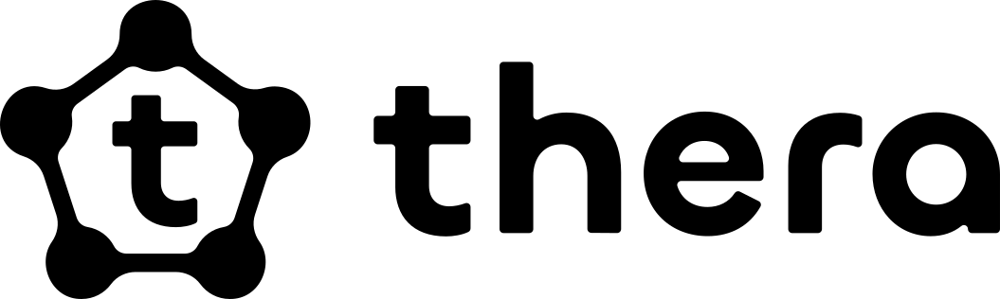

<p align="center">
  <picture>
    <source media="(prefers-color-scheme: dark)" srcset="public/brand/thera-horizontal-white.svg" />
    
  </picture>
</p>

<p align="center">
  🌱 <strong>Plant the right idea. Harvest real growth.</strong><br />
  The site of Thera — Matías Santillan’s software studio for growing businesses.
</p>

## 👋 What this is

Thera is a one-person software studio: every project is designed and built by Matías, directly with the client. This repo is its website — a single bilingual landing page (English at `/`, Spanish at `/es`) that explains how he works and invites people to start a project.

## 🗺️ A walk through the page

- 🌅 **Hero** — the promise, a first-person intro and the availability line (“up to three projects at a time”).
- 🌾 **How I work** — four seasons, Sow → Tend → Grow → Harvest, each with something concrete: a written analysis in 24 hours, a proof of concept in up to 72, a release every week and 30 days of support.
- 🛠️ **What I do** — five services as big rows. Hover one and it fills with light; click it and the project form opens with that service already picked.
- 🤝 **Directly with me** — who’s behind the work: portrait, a short bio and three commitments.
- 💬 **Good to know** — the questions people ask before writing, one answer open at a time.
- 🌳 **Let’s plant something** — the closing invitation.
- ✉️ **Project form** — a full-screen, three-step conversation (what, budget, details) that sweeps in over the page and lands in Matías’s inbox.

## ✨ Little things worth noticing

- 🌿 **Growing roots** — a three.js root system lives behind the whole page and grows as you scroll, crowding in around the close. See `components/widgets/growth-scene`.
- 🎇 **Cursor sparks** — lime sparks trail the mouse everywhere, leaving a faint ember when you stop. See `components/widgets/cursor-sparks`.
- 🫧 **Glass header** — a floating pill that tucks itself away while you read and comes back when you scroll up.
- 🎨 **Brand** — ink background, Chillax type and lime for every action. Tokens live in [`DESIGN.md`](./DESIGN.md) and `app/globals.css`.

Every animation respects reduced motion, and the page still reads well without WebGL or JavaScript. 💚

## 🧰 Built with

Next.js 16 · React 19 · TypeScript · Tailwind CSS v4 · GSAP · three.js · Radix UI · Zod · Vitest · Storybook · pnpm

The starter also wires in tRPC, Sentry and PostHog — they stay quiet until their environment variables are set.

## 🚀 Getting started

```bash
pnpm install
cp .env.example .env.local   # fill in what you need
pnpm dev                     # then open http://localhost:3000
```

### 🔑 Environment variables

Everything is optional while working locally — [`.env.example`](./.env.example) lists them all.

- 📬 `RESEND_API_KEY`, `CONTACT_EMAIL_TO`, `CONTACT_EMAIL_FROM` — send project inquiries through [Resend](https://resend.com). The sender must use a domain verified in Resend; without these, the form shows a friendly error instead of sending.
- 🐞 `NEXT_PUBLIC_SENTRY_DSN`, `SENTRY_*` — error tracking.
- 📊 `NEXT_PUBLIC_POSTHOG_KEY`, `NEXT_PUBLIC_POSTHOG_HOST` — analytics.
- 🌐 `NEXT_PUBLIC_APP_URL` — the site’s public address.
- 🖼️ `CHROMATIC_PROJECT_TOKEN` — visual reviews of Storybook.

### 🧪 Handy scripts

- `pnpm dev` — run it locally
- `pnpm build` and `pnpm start` — build and serve for production
- `pnpm test` — the test suite (`test:watch` keeps it running)
- `pnpm check:types`, `pnpm check:lint`, `pnpm check:format` — keep things tidy (`fix:lint` and `format` fix them for you)
- `pnpm storybook` — browse the components on port 6006

### 🐳 Deploying with Docker

```bash
cp .env.example .env         # fill in the production values
docker compose up -d --build # alfred's Caddy on the same VPS serves it at https://buildwiththera.com
```

`NEXT_PUBLIC_*` values are baked in at build time, so rebuild after changing them. The rest (`RESEND_*`, `CONTACT_EMAIL_*`) are read from `.env` when the container starts. The container publishes no port: it joins alfred's `live` Docker network as `thera-web`, and alfred's Caddy proxies `buildwiththera.com` to it (`deploy/Caddyfile` in the alfred repo).

## 📁 Where things live

- `app/` — routes (`/` and `/es`), the layout, global styles and fonts
- `components/landing/` — the landing page, one folder per section; the project form and its Resend action are in `closing/contact-form/`
- `components/widgets/` — the growing roots and the cursor sparks
- `components/ui/` — design-system pieces like Button, Dialog and Input
- `utils/` and `widgets/` — shared helpers, plus the tRPC, telemetry and analytics wiring
- `public/` — brand assets, icons and the portrait

✍️ Want to change the words? All copy, in both languages, lives in `components/landing/constants.ts`.

## 📚 More docs

- [`FOUNDATIONS.md`](./FOUNDATIONS.md) — how code is named and organized
- [`CONTRIBUTION.md`](./CONTRIBUTION.md) — branches, commits and pull requests
- [`DESIGN.md`](./DESIGN.md) — colors, type and spacing
- [`PRODUCT.md`](./PRODUCT.md) — who the site is for
- [`docs/`](./docs) — using tRPC and testing Sentry and PostHog
- [`MCP_SETUP.md`](./MCP_SETUP.md) — the MCP servers used while developing

<p align="center">Made with care in a one-person studio 🌱</p>
